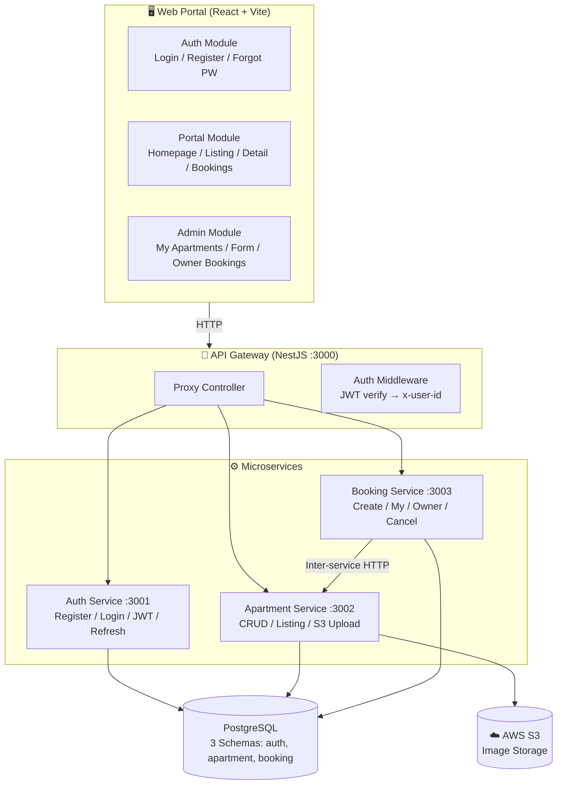
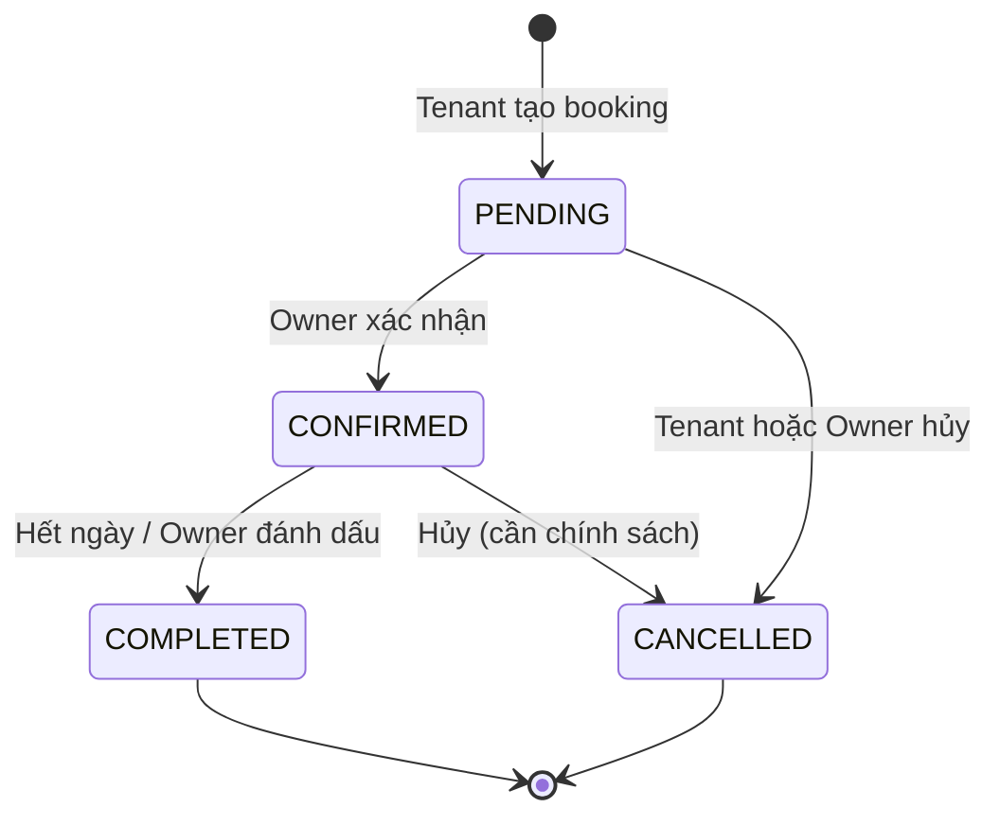

# 🏗️ Phân tích Luồng Nghiệp vụ — Hệ thống Đặt phòng & Quản lý Căn hộ (Cloud-Native AWS)

> **Đề tài:** Xây dựng hệ thống Đặt phòng và Quản lý căn hộ triển khai trên nền tảng Cloud-Native AWS

---

## 📊 Tổng quan Hiện trạng

### Kiến trúc hiện tại



### ✅ Những gì ĐÃ CÓ

| Layer | Feature | Trạng thái |
|-------|---------|------------|
| **Auth Service** | Register, Login (JWT + Refresh Token Rotation) | ✅ Hoàn chỉnh |
| **Auth Service** | Verify (cho Gateway), Me, Change Password | ✅ Hoàn chỉnh |
| **Auth Service** | Logout (revoke refresh token) | ✅ Hoàn chỉnh |
| **Apartment Service** | CRUD căn hộ (Owner), Public Listing | ✅ Hoàn chỉnh |
| **Apartment Service** | S3 Presigned URL Upload | ✅ Hoàn chỉnh |
| **Booking Service** | Tạo booking, Kiểm tra lịch trống | ✅ Hoàn chỉnh |
| **Booking Service** | My Bookings (Tenant), Owner Bookings | ✅ Hoàn chỉnh |
| **Booking Service** | Hủy booking, Xem chi tiết | ✅ Hoàn chỉnh |
| **API Gateway** | Proxy + JWT Auth Middleware | ✅ Hoàn chỉnh |
| **Frontend Auth** | Login / Register / Forgot PW / Staff Login | ✅ Hoàn chỉnh |
| **Frontend Portal** | Homepage, Dashboard, Apartment Listing | ✅ Hoàn chỉnh |
| **Frontend Portal** | Apartment Detail + Booking Modal | ✅ Hoàn chỉnh |
| **Frontend Portal** | My Bookings List + Booking Detail | ✅ Hoàn chỉnh |
| **Frontend Admin** | My Apartments (Owner), CRUD Form, Owner Bookings | ✅ Hoàn chỉnh |
| **Infra** | Docker Compose (Dev + Prod), Nginx, Dockerfiles | ✅ Hoàn chỉnh |
| **CI/CD** | GitHub Actions → Build + Push ECR | ✅ Hoàn chỉnh |
| **CI/CD** | Deploy to EC2 (script có, đang comment) | ⚠️ Đã viết, chưa bật |

---

## 🔴 Những gì CÒN THIẾU để hoàn luồng nghiệp vụ

### Mức độ ưu tiên: 🔴 Bắt buộc | 🟡 Nên có | 🟢 Có thêm điểm

---

### 🔴 P0 — Thiếu quan trọng (Cần có để luồng nghiệp vụ hoàn chỉnh)

#### 1. Chủ nhà Xác nhận / Từ chối Booking (CONFIRM flow)

> **Hiện trạng:** Booking tạo ra với trạng thái `PENDING` nhưng KHÔNG có cơ chế nào để chuyển sang `CONFIRMED` hoặc `COMPLETED`.

**Backend cần thêm:**
- `PATCH /Bookings/:id/confirm` — Chủ nhà xác nhận booking → `CONFIRMED`
- `PATCH /Bookings/:id/complete` — Đánh dấu hoàn thành → `COMPLETED`
- Kiểm tra quyền: chỉ Owner của căn hộ mới được confirm/complete

**Frontend cần thêm:**
- Nút **"Xác nhận"** / **"Từ chối"** trên trang Owner Bookings (`/quan-ly/bookings`)
- UI phân biệt rõ trạng thái PENDING → CONFIRMED → COMPLETED



#### 2. Tính totalPrice tự động ở Backend

> **Hiện trạng:** `totalPrice` được gửi từ client — **rất dễ bị tamper**. Backend nên tự tính dựa trên `pricePerNight × số đêm`.

**Cần sửa:**
- `booking.service.ts` → `create()`: Lấy `pricePerNight` từ apartment, tính `totalPrice = pricePerNight × nights`
- Loại bỏ `totalPrice` khỏi `CreateBookingDto` (hoặc chỉ dùng để đối chiếu)

#### 3. Review / Đánh giá sau khi ở

> **Hiện trạng:** Rating hiện đang hardcode random (`4.8 + Math.random()`) trên Dashboard. Chưa có model/API nào.

**Backend cần thêm (Review Service hoặc module trong Apartment Service):**

```prisma
model Review {
  id          String   @id @default(uuid())
  bookingId   String   @unique   // Mỗi booking chỉ review 1 lần
  apartmentId String
  tenantId    String
  rating      Int      // 1-5
  comment     String?
  createdAt   DateTime @default(now())
}
```

**API cần thêm:**
- `POST /Reviews` — Tenant tạo review (chỉ khi booking COMPLETED)
- `GET /Reviews?apartmentId=xxx` — Lấy review của 1 căn hộ
- `GET /Apartments/:id` — Trả thêm `averageRating` + `reviewCount`

**Frontend cần thêm:**
- Form đánh giá sau khi booking COMPLETED
- Hiển thị rating thực tế trên Apartment Card / Detail

---

### 🟡 P1 — Nên có (Tăng tính thuyết phục cho đề tài)

#### 4. Notification / Thông báo

> Hệ thống booking nào cũng cần thông báo. Có thể làm đơn giản bằng polling hoặc nâng cao bằng WebSocket/SNS.

**Phương án đơn giản:**
- Bảng `Notification` trong DB
- API `GET /Notifications` + `PATCH /Notifications/:id/read`
- Frontend: Bell icon trên header, hiển thị badge + dropdown

**Phương án Cloud-Native (điểm cộng cho đề tài):**
- **Amazon SNS** → push notification khi có booking mới
- **Amazon SES** → gửi email xác nhận booking

#### 5. Admin Dashboard (System Admin)

> **Hiện trạng:** Chỉ có Owner dashboard. Chưa có System Admin quản lý toàn bộ.

**Cần thêm:**
- Trang Admin Dashboard: Thống kê tổng quan (tổng users, apartments, bookings, revenue)
- Quản lý Users (danh sách, khóa tài khoản)
- Quản lý Apartments (approve/reject listing của Owner)
- Quản lý Bookings (xem tất cả, can thiệp nếu cần)

#### 6. User Profile / Quản lý Tài khoản

> **Hiện trạng:** Có API `GET /Auth/me` + `PATCH /Auth/change-password` nhưng chưa có trang Profile trên Frontend.

**Frontend cần thêm:**
- Trang `/profile` — Xem + sửa thông tin cá nhân (fullName, phone, address, avatar)
- API `PATCH /Auth/profile` ở Backend

#### 7. Search & Filter nâng cao

> **Hiện trạng:** Chỉ có search theo keyword (title). Filter chips trên Dashboard là placeholder (chưa hoạt động).

**Cần thêm:**
- Filter theo giá (min-max)
- Filter theo location/khu vực
- Filter theo amenities
- Sort (giá tăng/giảm, mới nhất, rating cao nhất)

---

### 🟢 P2 — Nice-to-have (Nổi bật cho bài bảo vệ)

#### 8. Payment Integration (Mock/Sandbox)

> Cho luồng nghiệp vụ đặt phòng hoàn chỉnh, cần có bước thanh toán.

**Phương án:**
- Tích hợp **VNPay sandbox** hoặc **Stripe test mode**
- Hoặc mock payment flow: Hiển thị QR code → Xác nhận thủ công
- Thêm trạng thái `PAYMENT_PENDING` vào BookingStatus

#### 9. AWS Services bổ sung (Đáp ứng "Cloud-Native")

> Đề tài nhấn mạnh **Cloud-Native AWS**, nên cần minh chứng sử dụng nhiều AWS services.

| AWS Service | Mục đích | Trạng thái |
|-------------|----------|------------|
| **EC2** | Host containers | ✅ Đã có |
| **ECR** | Docker registry | ✅ Đã có |
| **S3** | Image storage | ✅ Đã có |
| **RDS** | Managed PostgreSQL | 🟡 Nên chuyển từ self-hosted PG |
| **CloudWatch** | Logging & Monitoring | 🔴 Chưa có |
| **SNS/SES** | Notification / Email | 🟡 Nên có |
| **Route 53** | DNS / Domain | 🟡 Nên có |
| **ALB** | Load balancer | 🟡 Nên có |
| **CloudFront** | CDN cho frontend | 🟢 Nice-to-have |
| **Secrets Manager** | Quản lý secrets | 🟢 Nice-to-have |

#### 10. Responsive Mobile / PWA

> **Hiện trạng:** Chưa rõ responsive đã được test kỹ chưa.

**Nên kiểm tra:**
- Tất cả các trang trên mobile viewport
- Thêm PWA manifest nếu có thời gian

---

## 📋 Đề xuất Roadmap ưu tiên

> [!IMPORTANT]
> Dưới đây là thứ tự ưu tiên để **hoàn luồng nghiệp vụ cốt lõi** cho bài bảo vệ đề tài.

### Sprint 1: Hoàn luồng Booking cốt lõi (2-3 ngày)

| # | Task | Effort |
|---|------|--------|
| 1 | Backend: Thêm `PATCH /Bookings/:id/confirm` + `/complete` | 2h |
| 2 | Backend: Tính `totalPrice` tự động từ apartment price | 1h |
| 3 | Frontend: Nút Confirm/Reject trên Owner Bookings | 3h |
| 4 | Frontend: Cập nhật status flow UI | 2h |

### Sprint 2: Review & Profile (2 ngày)

| # | Task | Effort |
|---|------|--------|
| 5 | Backend: Review model + API (POST, GET by apartment) | 3h |
| 6 | Frontend: Form đánh giá (sau COMPLETED booking) | 3h |
| 7 | Frontend: Hiển thị rating thực trên Card/Detail | 2h |
| 8 | Frontend: Trang Profile + Edit | 3h |
| 9 | Backend: `PATCH /Auth/profile` | 1h |

### Sprint 3: Cloud-Native & Polish (2 ngày)

| # | Task | Effort |
|---|------|--------|
| 10 | Chuyển sang RDS (hoặc giữ nhưng document kiến trúc) | 2h |
| 11 | Thêm CloudWatch logging cơ bản | 2h |
| 12 | Bật Deploy job trên GitHub Actions | 1h |
| 13 | Search & Filter nâng cao | 4h |
| 14 | Admin Dashboard (stats overview) | 4h |

---

## 🎯 Kết luận

Hệ thống hiện tại đã có **~70-75% nghiệp vụ cốt lõi**. Điểm mạnh là kiến trúc Microservice rõ ràng, CI/CD pipeline đã setup, và UI premium. 

**3 việc quan trọng nhất cần làm ngay:**

1. **🔴 Confirm/Complete Booking** — Không có thì luồng booking "treo" ở PENDING mãi
2. **🔴 Tính totalPrice ở Backend** — Lỗ hổng nghiệp vụ rõ ràng
3. **🟡 Review/Rating** — Giám khảo sẽ hỏi "sau khi ở xong thì sao?"

> [!TIP]
> Nếu thời gian hạn chế, chỉ cần hoàn thành **Sprint 1** là đã đủ để demo một luồng nghiệp vụ E2E hoàn chỉnh: `Xem listing → Đặt phòng → Owner xác nhận → Hoàn thành → Hủy`.
