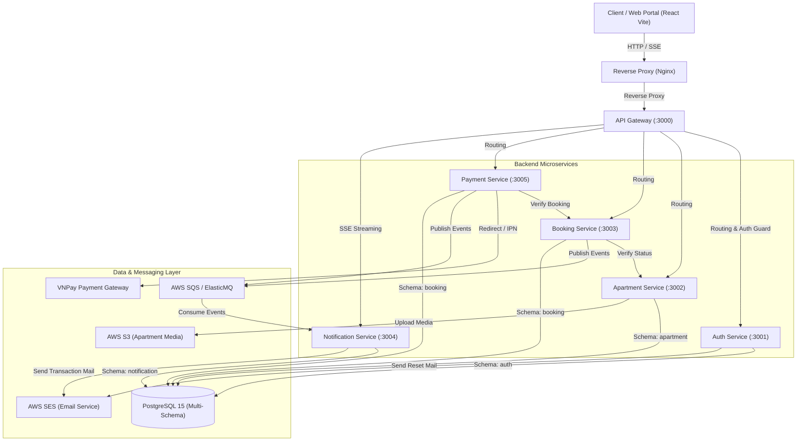

# ApartAWS - Hệ Thống Đặt Phòng Căn Hộ Trực Tuyến (Microservices Architecture)

[](https://opensource.org/licenses/MIT)
[](https://nodejs.org/)
[](https://nestjs.com/)
[](https://react.dev/)
[](https://www.docker.com/)
[](https://aws.amazon.com/)

**ApartAWS** là nền tảng quản lý và đặt phòng căn hộ nghỉ dưỡng trực tuyến, được thiết kế và xây dựng theo kiến trúc **Microservices** hiện đại, sẵn sàng triển khai trên nền tảng điện toán đám mây **Amazon Web Services (AWS)**.

Dự án cung cấp giải pháp toàn diện cho 3 nhóm đối tượng: **Khách thuê (Tenant)**, **Chủ căn hộ (Owner)**, và **Quản trị viên (Admin)**.

---

## 📑 Mục Lục
- [1. Kiến Trúc Hệ Thống (Architecture)](#1-kiến-trúc-hệ-thống-architecture)
- [2. Danh Sách Các Services](#2-danh-sách-các-services)
- [3. Công Nghệ Sử Dụng (Tech Stack)](#3-công-nghệ-sử-dụng-tech-stack)
- [4. Hướng Dẫn Cài Đặt & Chạy Local](#4-hướng-dẫn-cài-đặt--chạy-local)
- [5. Danh Mục Cổng (Ports) & API Routing](#5-danh-mục-cổng-ports--api-routing)
- [6. CI/CD & Triển Khai Production](#6-cicd--triển-khai-production)
- [7. Bản Quyền (License)](#7-bản-quyền-license)

---

## 1. Kiến Trúc Hệ Thống (Architecture)

Hệ thống áp dụng mô hình phân tán (Microservices) giao tiếp kết hợp giữa **Synchronous (REST/HTTP qua API Gateway)** và **Asynchronous (Event-Driven qua AWS SQS)**.



---

## 2. Danh Sách Các Services

| Service | Thư mục | Port | Mô tả chức năng |
| :--- | :--- | :--- | :--- |
| **API Gateway** | `apps/api-gateway` | `3000` | Điểm truy cập trung tâm (Single Entry Point), xử lý CORS, phân luồng request, xác thực JWT, kiểm tra quyền RBAC và chuyển tiếp luồng Server-Sent Events (SSE). |
| **Auth Service** | `apps/auth-service` | `3001` | Đăng ký, đăng nhập, cấp phát và xoay vòng JWT (AccessToken, RefreshToken), mã hóa mật khẩu với `bcrypt`, quên mật khẩu qua AWS SES. |
| **Apartment Service** | `apps/apartment-service` | `3002` | Quản lý danh mục căn hộ, tiện ích, địa điểm, quản lý upload hình ảnh lên AWS S3, quản lý và phản hồi đánh giá (Reviews & Ratings). |
| **Booking Service** | `apps/booking-service` | `3003` | Xử lý logic đặt phòng, ngăn chặn trùng lịch (Overlap Check), tính toán đơn giá theo đêm, quản lý vòng đời đơn (`PENDING`, `CONFIRMED`, `CANCELLED`, `COMPLETED`), đẩy sự kiện vào SQS. |
| **Payment Service** | `apps/payment-service` | `3005` | Tích hợp cổng thanh toán VNPay (Sandbox), sinh mã chữ ký bảo mật SHA-512, tiếp nhận và xác thực VNPay Return URL & IPN Webhook, cập nhật trạng thái đơn hàng. |
| **Notification Service** | `apps/notification-service` | `3004` | Consumer lắng nghe message từ AWS SQS queue, render template email HTML chuyên nghiệp và gửi qua AWS SES; đồng thời cung cấp SSE stream để đẩy thông báo realtime tới Web Portal. |
| **Web Portal** | `apps/web-portal` | `5174` / `80` | Giao diện Single Page Application (SPA) cho người dùng cuối, chủ căn hộ và trang quản trị hệ thống. |

---

## 3. Công Nghệ Sử Dụng (Tech Stack)

- **Backend:** NestJS, TypeScript, Prisma ORM, JWT, Passport.js, RxJS.
- **Frontend:** React 18, Vite, TypeScript, TailwindCSS, Ant Design, Axios, React Query.
- **Cơ sở dữ liệu:** PostgreSQL 15 (áp dụng mô hình *1 Database - Đa Schema* phân tách rõ ràng cho từng service).
- **Hạ tầng Cloud & Messaging:**
  - **Amazon S3:** Lưu trữ hình ảnh căn hộ với presigned URL / public bucket.
  - **Amazon SQS / ElasticMQ:** Hàng đợi thông điệp bất đồng bộ (Message Queue) đảm bảo tính sẵn sàng cao và chống nghẽn dịch vụ.
  - **Amazon SES:** Dịch vụ gửi email thông báo tự động đáng tin cậy.
  - **Amazon ECR & EC2:** Đóng gói Docker images và chạy hệ thống production.
- **Kiểm thử tải (Load Testing):** K6 + InfluxDB + Grafana Dashboard.

---

## 4. Hướng Dẫn Cài Đặt & Chạy Local

### Yêu Cầu Tiên Quyết
- [Docker](https://www.docker.com/) & [Docker Compose](https://docs.docker.com/compose/)
- [Node.js](https://nodejs.org/) phiên bản 20 trở lên (nếu muốn chạy trực tiếp không qua Docker)
- Git

### Bước 1: Clone Repository
```bash
git clone https://github.com/your-username/apartaws.git
cd apartaws
```

### Bước 2: Thiết Lập Biến Môi Trường
Sao chép file cấu hình mẫu ở thư mục gốc:
```bash
cp .env.example .env
```
*(Tùy chọn)* Điều chỉnh các tham số trong file `.env` nếu bạn muốn cấu hình AWS thật hoặc VNPay sandbox credentials của riêng bạn.

### Bước 3: Khởi Chạy Với Docker Compose
Chỉ với một câu lệnh duy nhất, toàn bộ cơ sở dữ liệu, hàng đợi SQS giả lập, API Gateway, 5 Microservices và Frontend sẽ được build và khởi động:

```bash
docker-compose up -d
```

Để theo dõi log các container:
```bash
docker-compose logs -f
```

Để dừng hệ thống:
```bash
docker-compose down
```

---

## 5. Danh Mục Cổng (Ports) & API Routing

Khi khởi chạy qua Docker Compose, các cổng dịch vụ được ánh xạ như sau:

| Dịch vụ | URL Local | Cổng Container | Ghi chú |
| :--- | :--- | :--- | :--- |
| **Web Portal** | `http://localhost:5174` | 5173 | Giao diện người dùng |
| **API Gateway** | `http://localhost:3000` | 3000 | Entry point cho tất cả API |
| **PostgreSQL** | `localhost:5432` | 5432 | Database chung (User: `user`, Pass: `password`) |
| **ElasticMQ SQS** | `http://localhost:9324` | 9324 | SQS Emulator UI / REST endpoint |
| **Auth Service** | `http://localhost:3001` | 3001 | Direct internal access |
| **Apartment Service** | `http://localhost:3002` | 3002 | Direct internal access |
| **Booking Service** | `http://localhost:3003` | 3003 | Direct internal access |
| **Notification Service** | `http://localhost:3004` | 3004 | Direct internal access |
| **Payment Service** | `http://localhost:3005` | 3005 | Direct internal access |

### Các Tuyến Đường API Chính Qua Gateway (`/api/*`):
- `/api/auth/*` $\rightarrow$ Đăng nhập, đăng ký, refresh token, gửi email quên mật khẩu.
- `/api/apartments/*` $\rightarrow$ Danh sách căn hộ, bộ lọc tìm kiếm, thông tin chi tiết, đánh giá & bình luận.
- `/api/bookings/*` $\rightarrow$ Tạo đơn đặt phòng, tra cứu lịch sử, hủy phòng, duyệt đơn của chủ nhà.
- `/api/bookings/payments/*` $\rightarrow$ Tạo URL thanh toán VNPay, nhận webhook IPN và return URL.
- `/api/notifications/*` $\rightarrow$ Lịch sử thông báo, kết nối Server-Sent Events realtime `/api/notifications/sse`.

---

## 6. CI/CD & Triển Khai Production

Dự án tích hợp sẵn quy trình CI/CD tự động thông qua **GitHub Actions** ([`.github/workflows/deploy.yml`](.github/workflows/deploy.yml)):
1. **Detect Changes:** Sử dụng `dorny/paths-filter` để chỉ build và deploy đúng các microservice có thay đổi mã nguồn.
2. **Build & Push Docker Images:** Đóng gói Dockerfile của từng service và đẩy lên **Amazon ECR** với tag commit hash.
3. **Deploy to EC2 via SSH:** Tự động kết nối tới máy chủ EC2, pull image mới nhất từ ECR, cập nhật container tương ứng bằng `docker-compose.prod.yml` mà không gây gián đoạn các service không liên quan.

---

## 7. Bản Quyền (License)

Dự án được phân phối dưới giấy phép **MIT License**. Chi tiết xem tại file [LICENSE](LICENSE).
