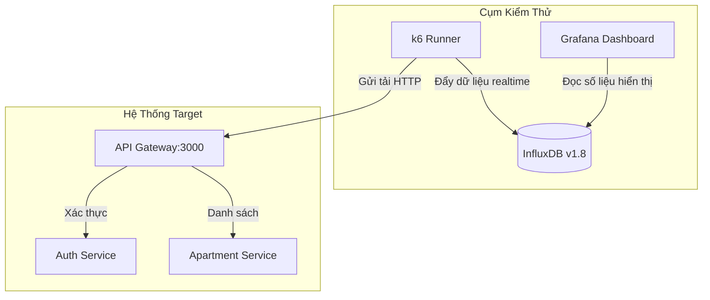

# Hướng Dẫn Triển Khai Kiểm Thử Hiệu Năng (Load Testing) với k6 và Grafana

Tài liệu này hướng dẫn chi tiết cách triển khai, cấu hình và chạy kiểm thử hiệu năng cho hệ thống **ApartAWS** dưới các mức tải **500 Users** và **1000 Users**.

---

## 1. Tổng Quan Kiến Trúc Kiểm Thử

Mô hình kiểm thử hiệu năng được triển khai dưới dạng các container Docker chạy trong cùng một mạng nội bộ (`apartaws_apart-network`) với hệ thống microservices để giảm thiểu độ trễ mạng vật lý bên ngoài và thu thập kết quả chính xác nhất:



*   **k6**: Công cụ tạo tải nhẹ, viết kịch bản bằng JavaScript, gửi các request mô phỏng người dùng thật.
*   **InfluxDB**: Cơ sở dữ liệu chuỗi thời gian (Time-series DB) nhận kết quả trực tiếp từ k6 theo thời gian thực.
*   **Grafana**: Công cụ giao diện đồ họa, tự động cấu hình Dashboard (`k6 Load Testing Results`) để hiển thị trực quan các biểu đồ (RPS, Latency, Error Rate).

---

## 2. Kịch Bản Kiểm Thử (User Journey)

Kịch bản kiểm thử được viết tại [k6/scripts/load-test.js](./scripts/load-test.js) mô phỏng hành vi thực tế của người dùng:
1.  **Duyệt căn hộ (70%):** Gọi API công khai `GET /api/apartments/listing` và xem chi tiết căn hộ `GET /api/apartments/{id}`.
2.  **Đăng nhập & Xem Profile (20%):** Mô phỏng người dùng đã đăng ký trước đó, đăng nhập qua `POST /api/auth/login` để lấy JWT, sau đó lấy thông tin cá nhân `GET /api/auth/me`.
3.  **Đăng ký tài khoản mới (10%):** Mô phỏng đăng ký tài khoản ngẫu nhiên `POST /api/auth/register`, sau đó đăng nhập ngay.

### Cơ chế Tăng/Giảm Tải (Ramping Profile):
*   **Với kịch bản 500 Users (Tổng thời gian: 7 phút):**
    *   **Ramp-up (0 -> 200 VUs):** 1 phút đầu (Khởi động hệ thống).
    *   **Ramp-up (200 -> 500 VUs):** 2 phút tiếp theo (Tăng tải từ từ).
    *   **Hold (500 VUs):** 3 phút (Duy trì tải ở mức 500 người dùng đồng thời để kiểm tra tính ổn định).
    *   **Ramp-down (500 -> 0 VUs):** 1 phút cuối (Kết thúc test).
*   **Với kịch bản 1000 Users (Tổng thời gian: 10 phút):**
    *   **Ramp-up (0 -> 500 VUs):** 2 phút đầu.
    *   **Ramp-up (500 -> 1000 VUs):** 2 phút tiếp theo.
    *   **Hold (1000 VUs):** 4 phút (Duy trì tải cực đại ở 1000 người dùng đồng thời).
    *   **Ramp-down (1000 -> 0 VUs):** 2 phút cuối.

---

## 3. Các Bước Triển Khai Chi Tiết

### Bước 1: Khởi động hệ thống ApartAWS chính
Đảm bảo hệ thống microservices đang chạy ổn định:
```bash
# Bật Docker service nếu chưa chạy
sudo systemctl start docker

# Khởi động hệ thống ApartAWS
docker-compose up -d
```

### Bước 2: Khởi động cụm InfluxDB & Grafana
Chạy lệnh sau để khởi động cơ sở dữ liệu InfluxDB và giao diện Grafana:
```bash
docker-compose -f docker-compose.k6.yml up -d influxdb grafana
```
*Lưu ý: Grafana đã được cấu hình tự động import Datasource InfluxDB và Dashboard k6 nên bạn không cần thiết lập thủ công.*

### Bước 3: Chạy thử kịch bản (Smoke Test)
Trước khi chạy tải nặng, hãy chạy thử 1 vòng với số lượng user nhỏ để kiểm tra xem API Gateway có phản hồi đúng hay không:
```bash
docker-compose -f docker-compose.k6.yml run --rm k6 run /scripts/load-test.js
```
Nếu màn hình terminal hiện kết quả không có lỗi `http_req_failed`, kịch bản đã sẵn sàng.

### Bước 4: Thực hiện chạy tải 500 Users và 1000 Users

#### 1. Chạy tải 500 Users:
```bash
docker-compose -f docker-compose.k6.yml run --rm -e TEST_TYPE=500_users k6 run /scripts/load-test.js --out influxdb=http://influxdb:8086/k6
```

#### 2. Chạy tải 1000 Users:
```bash
docker-compose -f docker-compose.k6.yml run --rm -e TEST_TYPE=1000_users k6 run /scripts/load-test.js --out influxdb=http://influxdb:8086/k6
```

---

## 4. Theo Dõi và Thu Thập Số Liệu Trên Grafana

1.  Mở trình duyệt truy cập: `http://localhost:3005` (hoặc IP máy chủ của bạn).
2.  Hệ thống tự động bỏ qua đăng nhập và đưa bạn vào quyền **Admin**.
3.  Vào mục **Dashboards** -> chọn thư mục mặc định -> click vào Dashboard **`k6 Load Testing Results`**.
4.  Khi quá trình test chạy ở **Bước 4**, bạn sẽ thấy các biểu đồ bắt đầu nhảy số liệu thực tế theo thời gian thực (realtime).

---

## 5. Hướng Dẫn Trình Bày Số Liệu Vào Báo Cáo Khóa Luận

Để bài báo cáo Khóa luận đạt điểm cao, bạn cần trình bày đầy đủ các nội dung khoa học sau:

### 5.1. Định nghĩa các chỉ số đo lường hiệu năng (KPIs)
*   **Virtual Users (VUs):** Số lượng người dùng ảo giả lập đồng thời.
*   **Requests Per Second (RPS / Throughput):** Số lượng yêu cầu mà hệ thống xử lý được trong 1 giây. RPS càng cao chứng tỏ hiệu năng xử lý của Gateway và các microservices càng tốt.
*   **Response Time (Latency):** Thời gian phản hồi của API (tính bằng mili-giây). Cần phân tích các mốc phân vị:
    *   `Average (Thời gian trung bình)`
    *   `p(90)` (90% số lượng request có thời gian phản hồi thấp hơn giá trị này)
    *   `p(95)` (95% số lượng request...)
    *   `p(99)` (99% số lượng request...) -> Dùng để đánh giá các trường hợp phản hồi chậm nhất (outliers).
*   **Error Rate (Tỷ lệ lỗi):** Tỷ lệ phần trăm các request bị lỗi (mã phản hồi 5xx hoặc timeout). Chuẩn thiết kế hệ thống tốt phải đảm bảo tỷ lệ lỗi < 2% dưới tải thiết kế.

### 5.2. Chụp ảnh minh chứng (Screenshots)
Trong quá trình chạy test 500 và 1000 users, chụp lại 2 màn hình Grafana hiển thị:
1.  **Biểu đồ tổng quan (Overview):** Cho thấy số lượng VUs tăng dần song song với lượng RPS tăng và Response Time duy trì ổn định.
2.  **Biểu đồ Response Time Distribution:** Phân tích chi tiết thời gian phản hồi theo từng API (đặc biệt so sánh giữa API công khai `/api/apartments/listing` và API xác thực `/api/auth/login`).

### 5.3. Mẫu bảng so sánh hiệu năng (Đưa vào Khóa luận)

Bạn có thể tổng hợp kết quả chạy thực tế vào bảng so sánh sau:

| Chỉ số hiệu năng (Metrics) | Mức tải 500 Users (VUs) | Mức tải 1000 Users (VUs) | Đánh giá / Nhận xét |
| :--- | :--- | :--- | :--- |
| **Tổng số Requests** | *VD: 150,000* | *VD: 280,000* | Tăng trưởng tuyến tính theo tải. |
| **RPS trung bình (Throughput)**| *VD: 450 req/s* | *VD: 820 req/s* | Khả năng đáp ứng của hệ thống. |
| **Response Time (Average)** | *VD: 85 ms* | *VD: 195 ms* | Thời gian phản hồi tăng khi tải tăng. |
| **Response Time (p95)** | *VD: 180 ms* | *VD: 450 ms* | Vẫn nằm trong ngưỡng an toàn (< 1.5s). |
| **Tỷ lệ lỗi (Error Rate %)** | *0.00%* | *VD: 0.12%* | Dưới ngưỡng cho phép (2%). |
| **Trạng thái hệ thống** | Hoạt động mượt mà | Bắt đầu quá tải nhẹ CPU | Do xử lý mã hóa mật khẩu (bcrypt). |

### 5.4. Viết nhận xét và đánh giá (Đề xuất giải pháp tối ưu)
*   **Phân tích điểm nghẽn (Bottlenecks):** Nhấn mạnh rằng các request liên quan đến đăng nhập/đăng ký (`POST /api/auth/login`) tốn nhiều thời gian xử lý nhất (Latency cao hơn) vì Auth Service phải thực hiện băm mật khẩu bằng thuật toán **bcrypt** (CPU-bound). Ngược lại, API lấy danh sách căn hộ (`GET /api/apartments/listing`) chạy rất nhanh (I/O-bound).
*   **Đề xuất tối ưu hóa (Recommendations):**
    1.  **Caching:** Áp dụng Redis Cache cho các dữ liệu ít thay đổi như danh sách căn hộ công khai để giảm tải cho database.
    2.  **Auto-scaling:** Trong thực tế triển khai Cloud (AWS ECS/EKS), khi CPU của Auth Service vượt 80%, hệ thống sẽ tự động scale-out (thêm replica) để san sẻ tải.
    3.  **Database Connection Pooling:** Tối ưu hóa số lượng kết nối tối đa từ Prisma đến PostgreSQL để tránh tình trạng "quá tải kết nối" ở mức 1000 Users.
